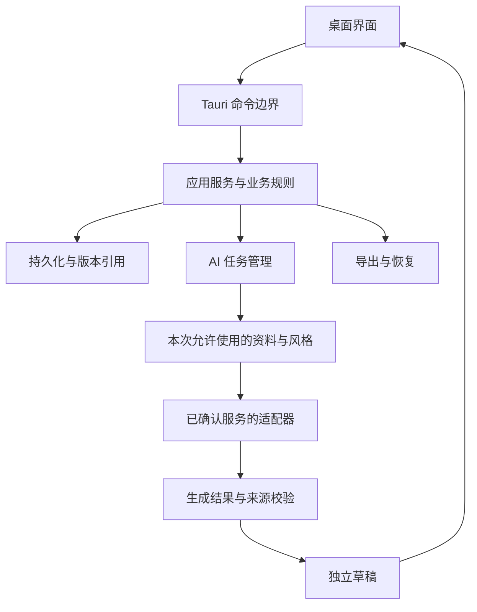

# 架构与技术选型

日期：2026-10-14。状态：DEC-12～DEC-15 已于 2026-10-15 由用户确认，待实现验证。Tauri 与产品范围已由用户确认，具体技术推荐见 [TECH_STACK.md](TECH_STACK.md)，数据与任务契约见 [DATA_AND_AI.md](DATA_AND_AI.md)。

## 1. 目标与决策顺序

架构围绕长期资料积累、可追溯创作、可靠保存和用户控制展开。先确认支持平台，再明确 AI 接入、资料隐私及输入/素材范围，之后比较具体框架、数据库、编辑器和测试工具。

首次正式交付同时支持 macOS 和 Windows，已由用户明确确认。最低系统版本及 CPU 架构待确定。当前工作不创建应用骨架，不预装技术栈。

两个平台均需验证安装、启动、升级、保存/恢复、文件路径与权限、凭据存储及真实桌面交互。业务规则共享，系统差异集中在平台适配边界；不得因开发机是 macOS 就将 Windows 标为已验证。发行签名、证书和双平台测试环境作为交付依赖记录。

## 2. 建议的职责边界

AI 接入方向已确认：同时支持用户配置模型服务/API Key，以及本机已安装的 Codex 等 AI 工具。服务调用与本机工具连接使用独立适配器，共享任务状态、来源范围和结果契约；具体接口与能力需研究后确定。由用户明确选择接入入口，失败时不自动切换。

本机工具接入需核实启动/连接协议、认证方式、流式输出、取消和权限控制，尤其要明确其是否读取文件或执行命令。不得直接读取或复用工具私有凭据，也不能假定“已安装”意味着可通过应用调用。其他工具名单待确认。

资料默认本地保存，不建设云同步。AI 输入由本次选定资料形成明确的版本快照，记录来源与目标接入入口。工具适配器不得默认暴露整个资料库；权限限制需要协议、文件隔离和实际验证支持，不能仅靠提示词。远程服务的保留政策与本地保存是不同边界，界面需说明实际发送目标。

| 层或模块 | 职责 | 对应需求 |
|---|---|---|
| 桌面界面 | 记录编辑、文字对话、图片、审稿、主题、旁白分镜与生活回顾 | REQ-01—15 |
| 应用服务 | 组织保存、整理、审稿、主题、项目、回顾与风格操作 | REQ-01—15 |
| 业务规则 | 原文与版本、引用关系、确认后的风格、事实/建议区分 | REQ-03/06/07/09/10 |
| 资料持久化 | 事务、迁移、查询、引用完整性、备份与恢复 | REQ-01/02/07/12 |
| AI 任务模块 | 明确输入范围、取消与状态、来源校验、结果草稿 | REQ-03—11 |
| 外部服务适配 | 根据确认的两类 AI 接入处理协议、认证及输出 | DEC-07/13 已确认；接口及权限待实现验证 |
| 系统集成 | 文件选择、导入导出、凭据管理、窗口与发行 | REQ-12、DEC-06/08 |

上述模块是职责划分，不意味着每个模块都需独立进程或独立服务。建议主要业务规则与系统访问集中在 Rust 侧，前端通过有限命令操作。是否需要本地模型进程或其他组件，取决于确认的能力范围。

## 3. 数据与交互流程提案

首发记录输入为文字、对话与图片附件。附件作为本地文件管理，持久化层保存稳定关联；备份/恢复需同时覆盖资料与附件。视频文件管理、媒体转录与内容理解不纳入当前实现范围，Vlog 分镜仅管理策划信息和用户描述的拍摄状态。图片附件的保留不意味着可自动传给模型。

保存时返回明确成功或失败状态；生成时固定来源版本和任务范围；返回结果保存为独立草稿；用户采用后再建立正式稿件版本。流式内容是生成进度，不自动等于完整已保存稿件。

## 4. Tauri 研究依据

2026-10-14 按项目要求使用 Context7 CLI，先解析 Tauri 库，选择官方文档库 `/tauri-apps/tauri-docs`，再查询 IPC、Channels 与权限边界。

- Tauri 前端与 Rust 核心通过 IPC 命令通信：[官方 IPC 文档](https://v2.tauri.app/concept/inter-process-communication/)。
- Channels 可用于 Rust 到前端的流式传输，适合后续研究生成进度传递：[调用 Rust](https://v2.tauri.app/develop/calling-rust/)。
- Rust 核心与插件拥有系统访问能力，不能把 Tauri 当作对核心代码的自动沙箱；输入校验和有限系统操作需应用落实：[安全边界](https://v2.tauri.app/security/)。
- Events/Channels 不提供与命令相同的细粒度能力控制；不得将敏感资料广播作为默认设计：[调用前端](https://v2.tauri.app/develop/calling-frontend/)。

具体命令权限配置及插件选择在实施前进一步查文档并验证。

## 5. 推荐架构与技术结论

| 项目 | 评价标准 | 推荐方案 |
|---|---|---|
| 前端框架与构建 | 长文编辑、复杂工作台、类型约束、维护与生态 | React + TypeScript + Vite |
| 编辑器 | 原文保存、段落定位、撤销与格式互通 | Tiptap 开源核心；应用维护版本与证据 |
| 本地数据库 | 事务、中文检索、版本和多对多引用、可验证备份 | SQLite + rusqlite；专用数据库线程 |
| AI 协议与客户端 | 取消、流式、结构化结果、费用和隐私 | Rust reqwest HTTP 适配器 + Codex App Server stdio 适配器 |
| 凭据与加密 | 平台支持、恢复与用户操作成本 | keyring 系统原生存储保护 API Key；资料加密另行决定 |
| 测试与发行 | 真实桌面交互、迁移恢复、安装升级、签名 | Rust + Vitest + WebdriverIO Tauri service；双平台发行验证 |

应用主体采用单体桌面架构，Rust 侧以模块组织职责。无需产品云端、常驻本地 HTTP 服务或跨进程业务微服务。Codex 是用户安装并授权使用的外部子进程，不作为默认随应用打包的模型运行时。

建议源代码目录按工作职责组织：前端 app/features/shared，Rust commands/application/domain/storage/ai/platform，数据库 migrations，测试 fixtures 与 e2e。当前只是目录方案，不建立空模块或占位接口冒充实现。

## 6. 两类 AI 接入

### 自配模型服务

推荐先明确支持 OpenAI Chat Completions 兼容的文字协议，配置服务地址、模型与 API Key；这是协议提案，其他原生协议按用户实际服务名单补齐。兼容性必须逐服务验证，不能承诺所有服务仅修改地址即可使用。[官方协议参考](https://developers.openai.com/api/reference/resources/chat/subresources/completions/methods/create)

HTTP 调用在 Rust 内完成，系统凭据不返回前端。端点更改需重新确认；禁止把认证请求自动重定向到不同目标，限制输出大小并处理流分片、超时、拒绝与截断。外部服务请求不开放模型工具调用，也不上传图片附件。网络失败仅报告，用户决定重试或换入口。[reqwest 配置依据](https://github.com/seanmonstar/reqwest)

### 本机 Codex 等工具

Codex 推荐使用 App Server 的 stdio JSONL 通道，由 Rust 直接启动已确认的可执行文件并管理生命周期。采用官方初始化、thread/turn 与通知流程，协议 schema 按对应 CLI 版本生成；认证状态通过官方接口处理，不自行复制工具凭据。[官方 App Server](https://developers.openai.com/codex/app-server/)

本机核实：CLI 为 0.146.0，帮助包含 app-server；生成 schema 成功。该版本稳定 schema 的 readOnly 只有网络字段，没有当前文档所述的细粒度读取路径结构。这证明本机协议不能按最新文档直接套用，不证明连接或权限隔离已经成功。

实现门槛：选用经双平台验证的兼容版本；隔离任务工作目录；默认不用现有历史线程；禁用 Shell、文件修改、浏览器、MCP/插件等非创作能力；核实配置继承及有效工具集合；禁止提权请求。工具无法满足资料范围限制时，该入口须报告不兼容，不能扩大权限或自动切换到 API。

“已安装 Codex”是可执行文件检测与用户授权连接，不等于能控制现有桌面窗口。其他本机工具必须有独立协议研究与验证，不采用任意命令模板或 UI 自动化冒充通用接入。

## 7. 体验与关键质量目标提案

工作空间建议：记录/对话、写作工作台、主题、Vlog 项目、生活回顾、个人风格、设置。采用资料导航、主体编辑区和按需打开的建议/来源面板；视觉设计在界面阶段细化。

共享体验规则：保存状态始终清楚；生成结果与原文对照；选定资料范围在任务启动前可见；空资料不展示虚构示例为个人记录；分镜导出包含拍摄清单，不要求连接剪辑软件。

拟定性能测试数据集：10,000 篇记录、每篇约 2,000 个汉字，长文用例 50,000 字，附件至少 1,000 张。候选目标为本地保存回执 p95 ≤ 500ms、分页浏览/普通关键词检索 p95 ≤ 1s；注明机器配置及测试样本。短词检索须单独量测，达不到目标则调整查询设计。上述是待接受和实测的质量目标，不是已实现成绩。

正确性门槛：持久化与重开一致；事务中断不产生半条记录；取消晚到结果不覆盖稿件；不存在来源不能标为有效；恢复后所有引用和图片可用；两平台均执行关键实际交互检查。

隐私门槛：密钥不在前端返回/日志/备份内；未选记录的标记文本不出现在发送内容；本机工具无法读取非选定资料，需用诱导读取与恶意来源文本进行验证。

## 8. 下一阶段与剩余决定

本次已输出技术选型比较、模块架构、实体关系、业务 IPC 契约、AI 生命周期、备份恢复设计与质量目标提案。开发环境建设步骤见 [DEVELOPMENT_PLAN.md](DEVELOPMENT_PLAN.md)。

推荐技术组合及 DEC-12～DEC-15 已由用户确认。剩余产品/发行选择：最低系统版本与 CPU 范围、是否需要资料加密和加密备份、除 Codex 外的本机工具名单，以及实际模型服务名单。接口细节、数据 schema 和锁定版本属于后续设计/实现验证，不用无证据结论填满。

2026-10-15：应用依赖与锁文件已建立，macOS 骨架构建、实际 IPC/SQLite/编辑器检查及 Codex 初始化握手已通过，详见 [开发环境说明](../development/ENVIRONMENT.md)。尚未调用模型、实现完整 AI 适配器或完成 Windows 实机验证；文档研究与本机骨架通过不代表完整业务或双平台发行通过。
