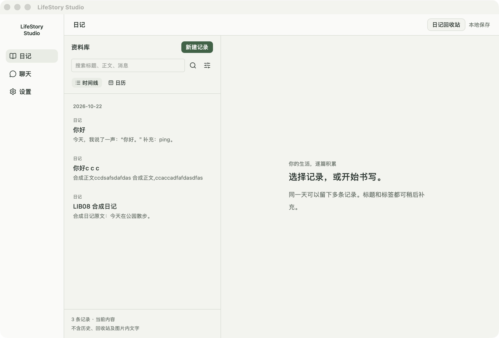
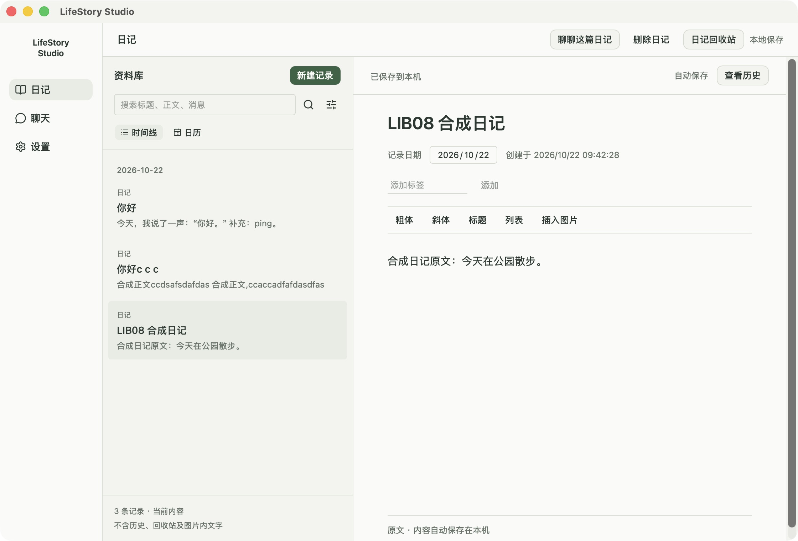
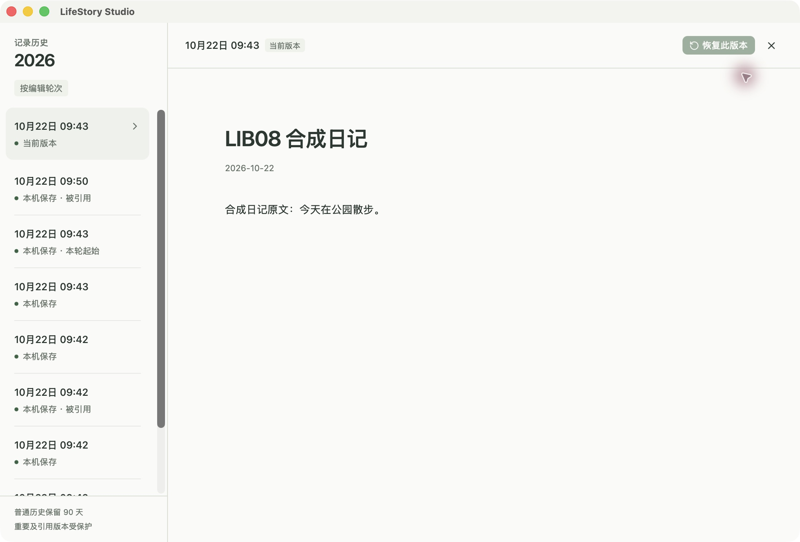
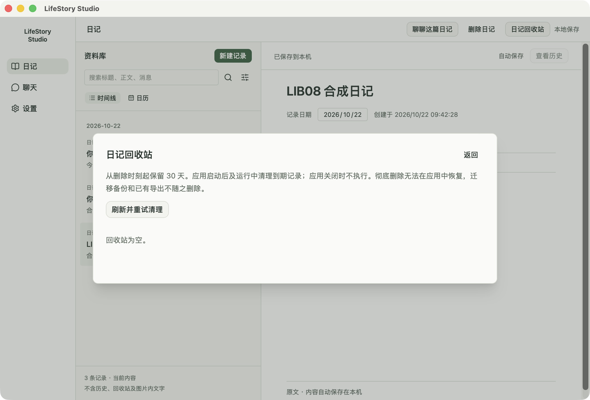
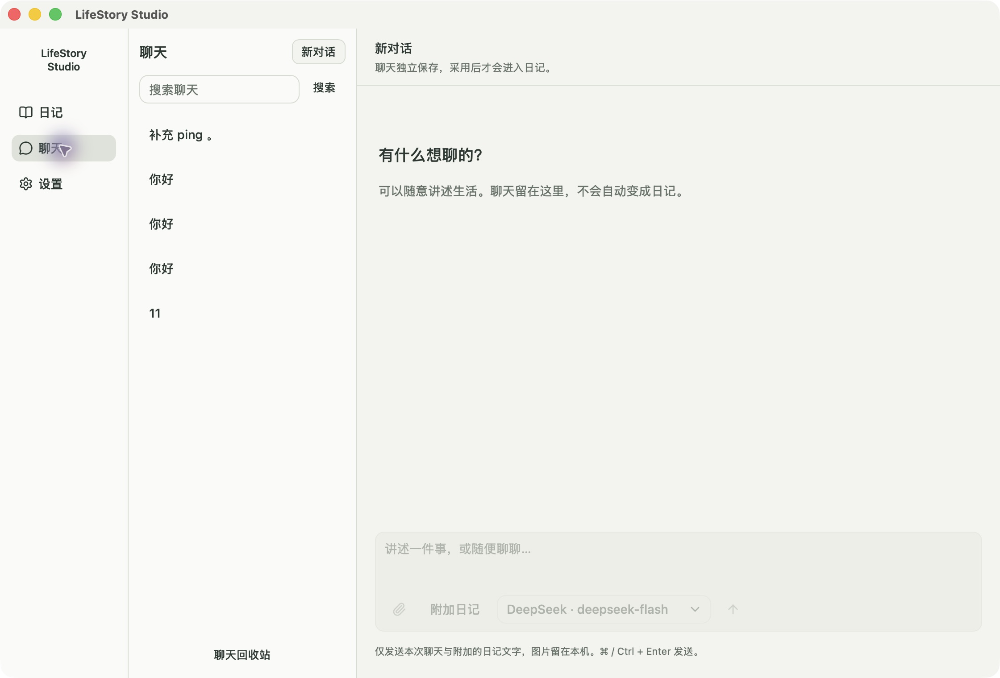
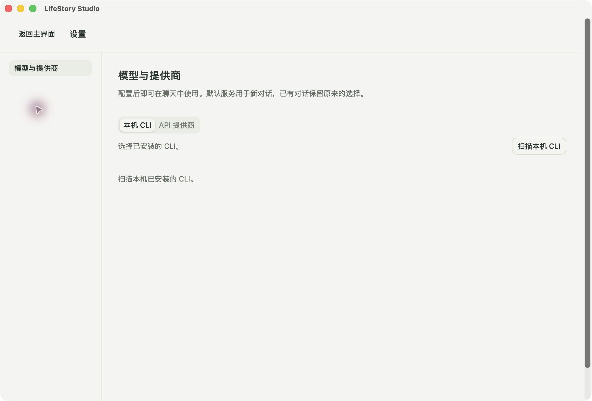

# TASK-08 现有功能 UI/UX 梳理与改善

日期：2026-10-22；更新：2026-10-27。状态：**用户确认本轮 UI/UX 集中改善告一阶段，TASK-08 阶段收尾**。后续随功能开发逐步完善，不再以全部 UI/UX 清单清零作为推进下一阶段的前置条件。尚未完成的快捷键、跨平台、输入法、辅助技术及完整任务体验验证继续保留；阶段收尾不等于全部验收。下一阶段为 [写作与风格](WRITING_AND_STYLE_NEXT.md)。

## 最新安排（2026-10-27）

本轮交付包括统一外壳/主题、日记列表/月历与独立编辑、共享日期/标签、全局搜索、设置回收站、历史独立页面、标题栏操作、可调宽侧边聊天、统一模型与强度、消息反馈、可编辑发送队列及 API 目录/自定义 ID。各轮证据见 STATUS 和实施验证，不将用户总体反馈扩写为逐项专项通过。

下方“剩余事项”改作后续持续改进与验证清单；历史中的“TASK-08 保持进行中/继续集中收尾”描述保留为当时记录，以本节最新安排为准。实际发现的数据丢失、隐私或阻断缺陷仍应及时处理；不再无依据反复重做整体布局。

## 1. 用户确认及目标

用户指出当前软件难用，明确要求先改善现有软件体验，再进入写作与风格，避免功能增加后再重整。此次作为 TASK-08 插入实施顺序：现有资料库与 AI/对话 → UI/UX 梳理与改善 → 写作与风格 → 主题与 Vlog → 生活回顾与输出 → 正式发行。

后续开发需求及相对顺序不变。LIB-09 保持已收尾；本任务不重开其验收，也不增加账号、云同步、支付或其他未授权业务能力。具体设计建议与用户已确认的阶段安排分别记录。

目标是让用户能顺畅完成记录、查找、聊天、预览采用、历史找回及配置服务，统一现有操作结构与视觉规则。沿用 Tailwind、shadcn/ui、语义主题变量和已有组件，不以删除既有能力换取页面简洁。

## 2. 设计基础先行（2026-10-22 修订）

用户指出尚未系统定义 UI/UX 基调和规则，要求使用相关技能继续建立。采用 teach-impeccable 工作流，先从现有资料提取已知内容，再逐项确认不能推断的偏好，更新根目录 .impeccable.md；不将设计建议自动视为用户确认。

现有 .impeccable.md 已记录“专业、紧凑、高效”，并注明来源为 2026-10-15 用户选择专业写作工具方向。它还包含内容优先、可选标题/标签、保存反馈、键盘及中文长文等原则。这是已有基础，不能声称从未有任何规则；但尚未形成导航、布局密度、视觉层级、组件状态及完整交互的系统规范。现有原则保留为历史依据；整体气质已由下方最新用户决定替代。

已知：个人生活记录与 Vlog 创作、macOS/Windows 桌面、长文/中文输入、内容可追溯、用户控制 AI、Tailwind/shadcn 组件体系。当前浅色绿色、系统字体和中性深色变量属于实现事实，不自动成为审美确认；存在深色变量不等于深色主题已完整交付。

已确认整体气质：2026-10-22 用户选择“灵感创作工作室：有表现力和探索感，强调选题与故事创作”。已同步 .impeccable.md，后续功能范围不因此改变，不提前添加主题或 Vlog 页面。

已确认视觉方向：2026-10-22 用户选择“沉浸创作式：深色、聚焦、少干扰，突出当前文字和画面”。深色作为主要视觉探索方向；主题支持范围按下方后续确认执行。

已确认工作区原则：2026-10-22 用户选择“按需收起：保留精简导航，列表和辅助面板可收起，把空间留给内容”。具体默认展开状态、尺寸和恢复入口在代表性页面中验证，不自行增加自动折叠或全屏机制。

已确认主题范围：2026-10-22 用户选择深色＋浅色＋跟随系统，默认跟随系统，也可手动固定主题；两套主题共用布局和交互规则。主题选择需持久化，跟随系统时响应系统变化，具体实现与验证放入 UX-05/06。

已确认参考：用户于 2026-10-22 进一步明确最喜欢 Codex 桌面软件的设计和交互；Codex 为首要参考，Cloudflare 控制台＋Notion 文档工作区为辅助参考。Codex 官方交互资料与用户提供的三张截图分析已完成，覆盖侧栏展开/收起和设置常规页；Computer Use 仍禁止本机实时访问，动态与未展示状态保留限制。详见 [Codex 参考分析](CODEX_UX_REFERENCE.md)。本轮已查阅官方公开交互资料，未访问用户账户，参考截图由用户提供，未复制含私人内容的原图入库；不冒充实时交互验证。已形成 [UI/UX 设计基础草案](UIUX_FOUNDATIONS.md)，区分用户确认与设计建议。

参考页面和反感特征已通过后续截图及多轮微调明确，不再作为设计启动阻塞。特殊可访问性需要尚未提供，不编造用户需求。键盘可达、焦点可见、清晰对比、非颜色单一传达及尊重系统减少动态效果作为设计建议，后续验证不预先宣称通过。每次只聚焦一个关键问题；已有产品定位和数据保护约束不重复询问。

设计基础产出应覆盖体验目标、产品气质、信息架构、交互原则、视觉规范、状态与可访问性。先明确方向，再用代表性页面验证，形成规范后改造完整流程。当前六屏证据保留用于检验方向，不直接作为定稿依据。

### 当前设计基础草案

以下为结合用户方向与既有需求形成的设计建议，尚未逐项审阅，不等于新增用户确认：

- 体验目标：容易开始记录、找到资料、继续创作；在主工作区清楚知道当前位置、当前对象和下一步。
- 信息架构：日记、聊天、设置保留清晰身份；采用后成文规则不变。未来模块沿用相同导航层级，本轮不实现未来页面。
- 内容层级：正文与画面优先；常用操作贴近对象；低频元数据按需展开；危险操作明确区分。
- 聚焦与恢复：面板可收起且可发现地重新展开；切换或收起不丢内容，焦点有明确去向；具体默认展开状态待验证。
- 视觉语义：深浅主题表达同一品牌；用表面层级、字体和有限强调色建立重点。禁用、选中、可操作和错误状态必须容易区分。
- 反馈与安全：正常保存反馈轻量，失败和冲突清楚且可行动；减少说明噪声，不隐藏后果或弱化保护。

以上是早期制定过程，已由后续代表性页面实施、用户指定数值与 UX-09～17 修订形成当前基线；不再将色值、尺寸、导航与布局整体列为未定稿。

## 3. 范围与工作拆解

| 子项 | 工作与交付 | 状态 |
|---|---|---|
| UX-00 | 建立体验目标、设计气质、信息架构及交互/视觉/可访问性原则，更新 .impeccable.md | 方向及主要视觉基线阶段收敛，保留用户明确数值与实现选择的区别 |
| UX-01 | 固定基线、梳理入口，捕获日记/聊天/设置/历史/回收站界面 | 首轮六屏完成 |
| UX-02 | 完整任务走查：书写与找回、搜索/日历/筛选、图片、聊天关联/预览采用、设置与返回、错误及未保存保护 | 部分完成；主要结构已实施，完整任务与异常流程仍需收尾，见剩余清单 |
| UX-03 | 按问题证据与影响确定信息架构、导航、主次操作、内容密度及状态反馈方案 | 主要信息架构与页面布局阶段收敛，后续仅按具体流程问题调整 |
| UX-04 | 建立统一布局、字体、间距、控件、弹窗、空状态与键盘规则，形成可审阅设计 | 共享规则与现有页面本地实现；主要视觉阶段收敛，流程/专项验证未全部完成 |
| UX-05 | 按完整流程实施，保留保存、引用、取消、权限及恢复保护 | 共享规则与现有页面本地实现；主要视觉阶段收敛，流程/专项验证未全部完成 |
| UX-06 | 按影响检查类型/构建、关键交互及桌面体验，记录用户审阅结果 | 对应自动化检查已有证据；完整实机与可访问性专项未全部完成 |
| UX-07 | 图标功能统一 Tooltip：覆盖主导航、标题栏、搜索/筛选、日历、编辑器、历史及聊天；支持鼠标和键盘，禁用说明可达 | 用户于 2026-10-23 确认验证通过，含无箭头、4px 间距及纵向组右侧定位 |
| UX-08 | 功能快捷键规划与接入：核对现有映射、macOS/Windows 差异、编辑器/中文输入冲突、发现入口及 Tooltip 展示 | 已有搜索、保存、发送及分隔线键盘操作；统一映射规划与更多功能覆盖尚未完成 |
| UX-09 | 清理冗余微文案/辅助说明/统计范围/常驻提示，调整布局，建立设计约束；保留必要反馈，不改业务 | 已清理并形成文案约束；纳入主要视觉基线，后续走查仅清理实际残留 |
| UX-10 | 应用外壳原生磨砂：标题栏、窄导航栏和内容框外围透明，列表/正文/聊天/设置保持原有背景，材质随主题切换 | 外壳透明范围与导航叠层已收敛；跨平台/系统辅助设置专项证据仍不足 |
| UX-11 | 统一原生滚动条外观：细圆角滑块、透明轨道、主题颜色、hover/拖动强调，保留现有滚动行为 | 方案与配色已按多轮反馈收敛，平台滚动/辅助设置专项仍待检查 |
| UX-12 | 日记全宽列表/月历首页与独立详情，日期弹层、浏览现场恢复及保存保护 | 列表/月历与独立详情结构已收敛并实施；完整流程验证见剩余清单 |
| UX-13 | 全局 Command 搜索与快捷操作，聊天逐条消息结果与定位，移除页面搜索框 | 统一搜索与命令菜单已接入，针对性自动化完成；长会话滚动等实机限制保留 |
| UX-14 | 日记标题与筛选打磨、完整可配置日期通用组件 | 日期/标签弹层与完整可配置日期组件已实施并形成基线；日记按适用能力启用 |
| UX-15 | 回收站集成设置独立页面，页内切换日记/聊天分类 | 页面结构已收敛并实施；相关交互检查完成，具体流程/专项验收未全部完成 |
| UX-16 | 页面标题栏操作插槽与日记详情、聊天操作迁移 | 页面结构已收敛并实施；相关交互检查完成，具体流程/专项验收未全部完成 |
| UX-17 | 日记右侧聊天、会话/草稿与保存协调、可调宽及本地记忆 | 右侧聊天与宽度规则已实施并形成基线；调宽新增 7 项检查通过，真实生成/采用流程待专项复核 |

验收以完整任务可理解、可操作、可恢复为准。样式检查通过不等于 UX 验收；按测试边界复用既有保护，行为变动才增加相应回归。后续实现前遵循 Git 流程，当前保留既有未提交文档，不自动提交推送。

## 阶段收敛与剩余事项（2026-10-26，当前状态入口）

用户表示本轮其主导的 UI/UX 已基本收敛。记录为**主要视觉与布局阶段收敛**，不把这一总体反馈扩写为每个用例、平台、异常状态及辅助技术均已验收。后续不再无依据反复讨论整体气质、配色或重做页面骨架；只围绕具体任务暴露的问题调整。

### 已形成的稳定基线

- Codex 为首要参考，深色沉浸；同时支持浅色与跟随系统，系统字体与 Lucide、Tailwind/shadcn、语义主题变量继续沿用。
- 40px 标题栏、窄导航、原生磨砂外壳与不透明内容区、轻边框/单层阴影、中性导航状态、轻滚动条、无箭头 Tooltip 与精简文案规则。
- 日记全宽列表/月历首页、独立编辑详情、日期/标签筛选、全局 Command 搜索；不再恢复日记常驻列表/正文分栏。
- 设置为独立页面，已有外观、模型与提供商、回收站分类；回收站页内区分日记/聊天，不使用列表弹窗。
- 标题栏右侧页面操作插槽已建立，日记详情与完整聊天页操作已接入；“聊聊这篇日记”打开右侧聊天，支持关闭、草稿/会话保留、可调宽及本地宽度记忆。

2026-10-26 后续明确微调：日记正文不显示蓝色外框；记录日期使用现有通用日历的单日选择能力；标签直接设置，创建时间移至返回工具栏右侧。已本地实现并完成相关检查，视觉由用户确认；作为 UX-12/14 的局部修订，不重开整体布局方向。

2026-10-26 标签后续修订：日期面板去掉快捷选择器，保留输入/月历；标签改为图标打开管理标签弹窗，包含所有日记/当前日记、复选、搜索创建和真实使用数量。已本地实现并通过相关检查，替代上一轮行内标签输入，未扩展标签重命名/合并/全局删除。

### 2026-10-27 最新收尾口径

聊天及模型设置这一轮新增内容已落地，不再列为待开发：统一模型搜索与来源标识、浮层内模型/强度、＋与 @ 附加日记、标题栏操作、消息复制/时间/用时/Codex 公开推理摘要、生成期间输入与可修改/移除的待发送队列，以及 API 保存前远程目录与自定义模型 ID。用户已确认实际聊天能够回复；其余逐项自动化、截图反馈与真实流程验收仍分开记录。

目前明确尚未完成的交互建设主要是 UX-08 系统化快捷键整理与必要接入。其余以体验走查和实际问题修正收尾：历史与恢复、日记/聊天回收站、日记→侧边聊天→补充/改写→采用/撤销的完整链路，以及跨页空/加载/失败/冲突状态。跨平台、小窗口、主题、长内容及键盘/输入法/辅助技术属于专项验证，不描述为功能尚未实现。

建议下一块检查历史与恢复，再检查回收站；当前聊天/模型设置可按最新实现做完整链路验收，无需无依据重新设计整体布局。分享或整篇日记复制仍属待定义扩展，已实现的单条聊天正文复制不再算未决。

### 尚未收尾的既有范围

以下是剩余工作清单，**不是认定对应功能未实现或已经发现缺陷**。已有自动化与旧版业务验收继续有效；缺少的是当前新布局下完整任务的体验结论，不能以旧截图或代码检查替代实机证据。

| 范围 | 剩余工作 | 对应任务与收尾依据 |
|---|---|---|
| 聊天与预览采用 | 串联统一模型/强度、＋/@ 附加日记、发送/流式/摘要/复制/计时、停止/排队/修改/删除/继续及失败重试、补充/改写预览、采用/撤销、全页/侧边切换；核对长消息滚动与草稿保留 | UX-02/03/17；新布局下实际走完代表性链路，有问题再局部调整 |
| 模型与提供商设置 | 串联 CLI 自动扫描/模型选择/统一保存、API 新配置保存前读取目录/自定义 ID/默认/停用、显式测试与取消、局部加载/错误及未保存保护 | UX-02/04/05；CLI/API 结构、局部异步状态、远程目录及自定义 ID 已实现，分轮自动化证据见 STATUS；当前完整桌面流程仍待逐项验收，不新增服务能力 |
| 历史与恢复 | 独立页面已按 2026-10-27 用户要求实施；剩余为多版本、长文/图片时的查找/预览/重要标记/恢复确认/返回编辑及焦点实机收尾，版本摘要不重复列为未开发 | UX-02/04/06；检查新标题栏入口下的完整恢复路径与辨认成本 |
| 回收站有内容与异常状态 | 日记/聊天分类、分页、恢复、取消/确认彻底删除、清理失败/重试及返回原工作区 | UX-02/05/15；设置页布局已做，真实有记录/失败场景尚未在本轮完整走查 |
| 跨页状态与交互一致性 | 空库/无结果/加载/失败/冲突、长标题/标签、菜单与确认层、退出/返回后的焦点和滚动；复核是否残留冗余文案、重复入口或不可达操作 | UX-02/04/09；不新增说明性页面或统一大框架，仅解决实际出现的问题 |
| 系统化快捷键 | 整理实际已有映射，确定需要新增的操作与平台键位，核对中文输入/编辑器/系统冲突，并同步真实可用的菜单或 Tooltip 展示 | UX-08；尚未完成系统规划与新增接入。已有 ⌘K/Ctrl+K、⌘S/Ctrl+S、⌘Enter/Ctrl+Enter 及分隔线键盘调宽继续保留 |

### 单列的验证缺口（不等于设计未定）

- 当前新布局下的 Windows 原生交互、不同窗口尺寸、深浅主题完整状态对照、长文/图片/长聊天的真实滚动与性能。
- 全键盘路径、弹层焦点与返回、真实中文输入法、读屏、对比度数值、减少动态效果与系统辅助显示设置；已有局部自动化不能替代这些实机结论。
- 右侧聊天宽度记忆、原生指针捕获/窗口缩放与 IPC/真实生成采用的组合验证；没有提供明确证据的专项继续保留，不能整体标为通过。

**此前建议顺序（已由 2026-10-27 阶段安排取代，不作为下一阶段前置）**：先走查“编辑日记 → 右侧聊天 → 补充/改写预览 → 采用/撤销 → 继续编辑/返回”，随后模型配置，再走历史/回收站，最后补齐跨页一致性、快捷键与专项检查。建议顺序不授权自动调用付费服务、使用私人材料、操作用户应用或发布产品；视觉继续由用户验证，提供具体检查步骤。

### 不混入本轮收尾的事项

日记分享、整篇复制的具体语义及其实现仍未定义（单条聊天正文复制已实现）；除已接入的日记与聊天外，其他模块是否也迁移操作到标题栏，属于可选扩展，需要具体问题或后续需求，不自动当作 TASK-08 必做缺陷。当前已支持右侧聊天，不能继续列为未实现。写作与风格、主题/Vlog、回顾/输出等后续业务需求及相对顺序保持不变；LIB-09 不重开。构建大包警告作为技术风险记录，不冒充视觉设计待定项。

TASK-08 已按用户 2026-10-27 指示阶段收尾；流程与专项事项继续跟踪，不能据此声称全部完成。下方六屏及早期建议为历史证据，不再代表当前界面。

## 4. 首轮走查基线与证据（2026-10-22）

使用 Computer Use 访问真实 Tauri 桌面窗口。先打开普通名称 LifeStory Studio，发现仍为旧文字记录界面，排除出本轮证据。改用已验收的 LifeStory Studio LIB08 Revision，bundle ID 为 com.lifestory.studio.lib08-revision-validation，与 LIB-09 记录的包身份一致；本轮未重新计算包哈希，不宣称是新构建。

只选择明确命名的合成日记，未编辑正文、恢复版本、删除记录、改变配置或调用模型。截图保留在 uiux-evidence/，均已从保存文件重新打开检查。首次未选中记录的窗口标题栏呈非激活状态，内容可辨认；不据此判断文字对比度。

## 5. 首轮步骤与观察

下列是本轮现场证据，不以旧截图或源码猜测替代。优先级 P2 为体验问题，P3 为局部细节；本轮没有据此认定数据丢失或功能阻断。

### 1. 日记列表：可进入，信息重复及空间分配需改善

- 优点：日记、聊天、设置入口明确，新建按钮突出；搜索和日历可发现。
- UX-OBS-01 / P2：页面“日记”、列表“资料库”、每条“日记”重复表达层级；在只有日记的列表里增加阅读噪声。建议统一用户用语，减少无助于区分的标签。
- UX-OBS-02 / P2：左侧导航和列表占据明显横向空间，未选中时右侧只有说明，主要操作仍在远处列表顶端。建议明确空工作区的下一步，并统一列表/正文空间分配；是否可折叠需结合小窗口验证后定案。
- 可访问性：搜索和筛选在 AX 中有名称；图标对新用户是否易懂、键盘焦点及缩放后表现仍需验证。

### 2. 打开合成日记：正文可读，工具及元数据抢占注意力

- 优点：保存状态可见，标题与正文层级明确，历史入口可直接找到。
- UX-OBS-03 / P2：聊天、删除、回收站同列置于页顶；删除与常用操作视觉相近。建议将记录操作贴近当前记录，区分常用与危险操作，保留明确确认及删除影响展示。
- UX-OBS-04 / P2：保存状态、自动保存、创建时间、标签及格式栏占据正文上方多层空间，底部又重复本地保存说明。建议突出正文，将低频元数据和重复解释收敛，不删除保存失败反馈。
- 可访问性：正文和格式工具有名称；标题/日期/标签的键盘顺序、焦点及长文滚动待实测。

### 3. 查看历史：基本分栏成立，版本辨认成本较高

- 优点：历史列表和只读预览分开，当前版本恢复按钮禁用，返回入口可见。
- UX-OBS-05 / P2：多个版本显示相同分钟及“本机保存”，肉眼难区分内容变化；“本轮起始”“被引用”等词偏实现概念。建议在不更改历史生成规则的前提下，提供易理解的版本摘要和状态说明。
- 可访问性：关闭图标在 AX 中有“关闭历史”名称；焦点返回与键盘遍历尚未验证。不能由图标外观断言无可访问名称。

### 4. 打开日记回收站：可返回，空状态被规则说明盖过

- 优点：30 天与不可恢复边界已说明，当前空状态清楚。
- UX-OBS-06 / P2：空回收站中，“刷新并重试清理”仍是主要可见操作，混合刷新与失败恢复意图；长段运行时/备份说明先于实际内容。建议分离正常刷新与失败重试，把详细保留规则按需展开，同时保留必要的隐私及不可恢复说明。
- 限制：没有为截图制造删除数据，未走查有记录时的恢复/彻底删除页面；弹窗焦点约束、Escape 关闭仍待验证。

### 5. 切换聊天：可进入，列表与输入区一致性需改善

- 优点：聊天独立保存、资料发送范围及发送快捷键均有说明；服务可选择。
- UX-OBS-07 / P2：聊天列表比日记列表窄，搜索按钮与日记的图标搜索形态不同；新建也分别叫“新对话”“新建记录”。建议统一列表骨架与搜索交互，用词保留必要业务差异。
- UX-OBS-08 / P2：输入区边界、占位文字、服务选择和可用附加操作的视觉强度接近禁用图标。可用/不可用区分偏弱，具体对比度尚未测量。建议使用主题语义明确区分状态，禁用图片入口需解释可用条件或按当前能力处理。
- 限制：未读取历史聊天正文或发送消息，未走查生成/失败/取消/预览采用；列表中的重复“你好”仅是合成数据，不能据此断言自动标题算法有缺陷。

### 6. 进入设置：可以返回，导航框架切换明显

- 优点：默认服务对新旧聊天的影响有说明，本机与 API 两类入口分开。
- UX-OBS-09 / P2：进入设置后全局导航消失，改成“返回主界面”加只有一个项目的分类栏；与日记、聊天的切换方式不同。建议统一设置的导航层级与返回位置，让当前位置和返回目标更清楚；本轮不直接决定保留侧栏或改成弹窗。
- UX-OBS-10 / P3：CLI 首屏“选择已安装的 CLI”与“扫描本机已安装的 CLI”重复，说明与扫描按钮距离较远。建议把简短解释和操作组合成清晰任务区。
- 限制：未扫描 CLI、切换 API 配置、读取凭据或测试连接；表单保存/未保存保护与错误反馈待后续走查。

## 6. 首轮建议与验证边界（历史记录，当前实现见实施验证）

先完成 UX-00 设计基础，再用代表性页面验证方向，随后统一工作区结构与导航、各页面主次操作和视觉细节。现有日记/聊天身份、预览采用后成文、默认追加与数据保护规则继续沿用。设计建议尚未标为用户确认，也未称界面已经改善。

下一步：基于已确认的灵感创作工作室气质，基于已确认的深色沉浸方向，确认工作区交互并形成设计基础；随后补齐 UX-02 的搜索/筛选、日历、已有聊天关联与预览采用、设置表单及返回路径等现场证据，形成完整问题优先级与页面方案；涉及模型的流程优先复用既有合成测试条件，不擅自调用付费模型或处理私人素材。未访问的流程不能提前判定通过或失败。

当前截图只覆盖 macOS 单一窗口尺寸的六个状态。Windows、不同尺寸、深色主题、屏幕阅读器、完整键盘操作及对比度数值未检查，不宣称完整可访问性合规。应用代码未修改，应用测试未运行；文档差异与图片引用检查见本次会话。

2026-10-23 实施补记：下方首轮观察与早期“下一步”保留为历史依据；当前本轮已实现并完成对应验证，以 [UI/UX 实施验证](UIUX_VERIFICATION.md) 为准，不再以早期未开始状态解释当前成果。

2026-10-26 UX-14 补充：用户要求完整组件与场景配置分离。共享面板、规则与动态日期 hook 已提取，默认提供截图全部能力；日记按需配置，相关自动化通过，视觉仍待用户验收。

2026-10-27 历史与恢复改为独立页面：已替代原模态 HistoryPanel，沿用版本列表/预览/恢复保护；页面迁移与当前证据见 [历史页面](HISTORY_PAGE.md)，相关实机专项继续保留。
