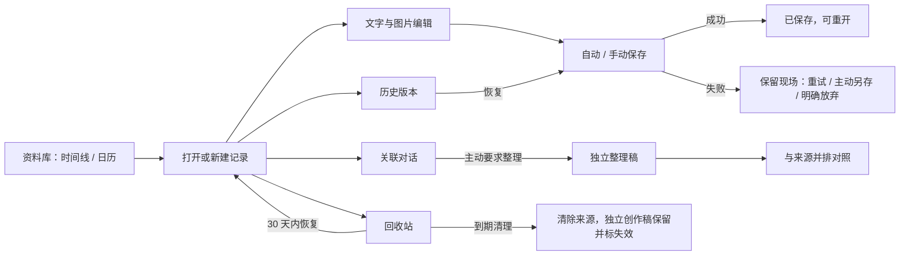

# 资料库与日常记录：页面流程与任务拆解

确认日期：2026-10-15；更新：2026-10-21。状态：已确认并在实施，LIB-01—05 已有成果，LIB-06 本地实现与 macOS 关键流程验证完成，用户验收通过，LIB-07 已验收并合入 develop（PR #19），LIB-08 本地实现及合成链路验证完成，用户已确认真实 Codex/API 与 Windows 主链路通过，LIB-09 剩余专项证据核对中；平台验证限制与当前进度见[项目跟进](../tracking/STATUS.md)。关联 TASK-07；依据为 [功能规格](LIBRARY_AND_RECORDING.md) 中四轮用户确认及 REQ-01/02/03/12/13/14。

本稿将已确认行为组织成可审阅流程。用户本次确认本稿页面流程、收敛建议与任务顺序；涉及图片支持矩阵及技术参数的项目仍需按确认的验证步骤确定，不将其视为已验证。AI 对话与整理依赖实际 AI 适配器，不能用模拟回复冒充完成。

## 1. 页面结构

| 区域 | 内容 | 确认程度 |
|---|---|---|
| 资料库入口 | 时间线/日历切换，新建文字/对话，搜索及筛选 | 行为已确认；布局为建议 |
| 记录列表 | 标题或内容截取、记录日期、类型、标签、图片提示 | 行为已确认；信息密度为建议 |
| 内容区 | 原文编辑，日期/标题/标签，保存状态，正文图片 | 行为已确认 |
| 关联区 | 关联对话、整理稿、来源与按需并排对照 | 行为已确认 |
| 历史页面 | 全窗口左侧版本导航、右侧只读预览，顶部恢复与关闭；查看版本、标记重要、恢复为新版本 | 行为已确认；2026-10-19 用户要求参考图中的分栏设计，本轮已实现，最终视觉仍待用户审阅 |
| 回收站 | 记录、删除时间、预计清理时间、恢复 | 行为已确认；分组为建议 |
| 恢复提示 | 较新本地草稿预览、恢复或丢弃 | 行为已确认 |

建议桌面采用“资料库导航与列表 → 主内容 → 可展开关联区”。日历选择日期后，列表展示当天记录；窄窗口将关联内容切换展示，并排对照为可选状态。视觉样式和具体尺寸留给界面设计。

## 2. 完整用户流程

### 记录、保存和重开

新建记录时默认今天，标题和标签可选；同一天可创建多条。文字可直接写入，图片可选择文件、拖入或粘贴，多张逐一报告结果。图片复制进入本地受管理目录并直接插入正文，三种入口结果一致。失败就地反馈，成功不需要再次选择呈现方式。

停止输入片刻后自动保存，手动保存立即提交。待保存、保存中、已保存、失败分别展示；不能用发出请求代替成功回执。编辑期间先发出的保存结果不得把较新编辑误标为已保存。版本冲突不覆盖新内容，保留现场并展示冲突。

切换记录或正常退出先处理待保存内容；失败允许留在当前页面、重试、主动另存或明确放弃。另存成功不等于资料库保存成功。重开读取正式保存版本；若有较新恢复草稿，先预览选择，不静默覆盖。恢复副本在正式保存成功前不得提前清除。

### 文字、对话和整理稿

可直接新建对话，也可从已有文字发起关联对话。调用前显示接入目标与明确选定资料，默认不发送图片。未配置或不可用的 AI 入口明确提示，不自动切换或生成模拟回应。

AI 轻回应、少量追问，用户要求后才生成独立整理稿。整理稿关联实际来源版本，多篇整理可以逐条打开来源。原文为主，关联区打开对话和稿件，需要时对照。切换内容遵循同一套保存保护。

### 检索与日期

关键词搜索当前标题、正文和对话消息，组合日期、类型、标签、有无图片；多标签可选全部/任一满足。旧版本、回收站、图片内文字和独立 Vlog 项目不进入默认结果。命中可打开对应内容，结果显示当前筛选范围。

记录日期固定，系统时区变化不移动旧记录；新建以当前系统时区确定今天并记录时区。创建/修改时刻另存绝对时间。用户修改记录日期后改变日历归属，编辑正文不改变归属日期。

### 版本、删除与附件

旧版可查看、标重要并恢复为新版本。普通历史 90 天，当前版、重要版与被引用版不按普通期限清理。

删除记录先展示关联影响，再移入回收站，30 天内可恢复，到期自动清理；应用关闭时不承诺执行，下次运行处理到期项。彻底删除清理原文、历史、恢复草稿、索引及引用摘录等应用管理的来源副本，独立创作稿保留并标记来源已删除。外部导出与备份不能追溯清除。2026-10-21 用户确认提供提前彻底删除入口，二次确认后立即执行。

2026-10-20 修订：移除正文图片可撤销，找回使用记录历史，历史可复制单图粘回当前正文。取消附件区、文字图片引用和图片独立回收/30 天恢复。物理图片按当前/历史/消息/草稿等有效关系保留；记录回收站规则不变。

## 3. 已确认的收敛建议与技术验证边界

以下收敛建议按表中最新确认日期执行；图片恢复已由 2026-10-20 决定替代。图片格式与上限仍按本表约定开展技术验证后确定；其他技术参数在 LIB-01 中细化。

| 项目 | 建议 | 影响 |
|---|---|---|
| 图片恢复（2026-10-20 替代确认） | 统一编辑撤销与记录历史；历史可复制单图再粘回 | 无图片独立恢复逻辑；保留新文字 |
| 风格证据失效 | 失去全部有效证据的风格判断暂停用于生成，提示重新确认；保留用户独立手填偏好 | 删除原文后不继续沿用无依据推断 |
| 图片格式与限制 | 独立技术验证后确定支持矩阵和上限，不预先承诺 HEIC/GIF 等格式；拒绝不支持项并说明 | 双平台解码、安全与资源消耗；不自动转码 |
| 批量导入 | 逐张提交与报告，成功项保留、失败项由用户重试 | 清楚区分部分成功，不自动重复导入 |
| 标签管理 | 支持新增、重命名、移除；同名归一规则在契约中确定，移除标签不删除记录 | 检索一致性；不自动推断分类 |
| 时间线与筛选 | 按记录日期倒序，同日按创建时刻倒序；切换视图保留关键词与非日期筛选，日历选日替换日期范围并展示 | 补写、跨视图操作结果可解释 |
| 列表类型 | 文字、对话、整理稿三个可辨类型；整理稿在来源关联区与资料库可达，同一稿件不复制 | 避免来源和稿件混淆 |
| 历史与恢复写入 | 不变版本和可覆盖恢复草稿分离；期限按版本创建时刻，清理前重新校验引用 | 防止历史合并或后台清理破坏引用；合并粒度在技术方案确定 |

## 4. 依赖与任务拆解

这些是实施顺序，不是功能裁剪。LIB-01 已完成契约设计与图片解码验证，LIB-02 已实现并通过 macOS 本机验证，LIB-03 已实现单一自动持久化与失败离开保护；新编辑直接读取当前内容，旧版遗留草稿保留预览选择，LIB-04 历史管理已实现并通过 macOS 关键链路验证，Windows 实机仍待验收，LIB-05 已按 2026-10-20 确认修订为正文图片和记录历史，取消独立图片恢复；本地实现与部分 macOS 原生链路验证已完成，原生拖入与 Windows 实机待验收；LIB-06 本地实现与 macOS 关键流程验证完成，用户验收通过，LIB-07 已验收并合入 develop（PR #19），LIB-08 本地实现及合成链路验证完成，用户已确认真实 Codex/API 与 Windows 主链路通过，LIB-09 剩余专项证据核对中；不将设计验证视为已完成业务功能。

| ID | 交付 | 依赖 | 完成与验证依据 |
|---|---|---|---|
| LIB-01 | 明确剩余范围，形成数据/IPC/编辑文档契约与迁移方案 | 本稿关键建议确认 | 记录/版本/消息/稿件/附件/引用模型一致；不混淆原文和草稿 |
| LIB-02 | 文字记录创建、保存、重开、日期及标题标签 | LIB-01 | 真实 SQLite 保存重开、冲突/失败不覆盖；桌面输入法及保存状态链路 |
| LIB-03 | 自动保存、失败离开保护与恢复草稿 | LIB-02 | 延迟回执、失败、退出、异常重开场景；恢复保存前副本安全 |
| LIB-04 | 历史查看、重要标记、恢复、清理 | LIB-02/03 | 已实现；真实 SQLite 恢复/90 天边界/引用保护与 macOS 交互通过，Windows 实机待验收；见 [LIB-04 验证记录](../development/LIB04_VERIFICATION.md) |
| LIB-05 | 图片直接插入正文、就地编辑与历史复制 | LIB-01/02/04，2026-10-20 修订确认 | 2026-10-21 用户验收通过；原子保存、三入口、多图部分失败、撤销/历史复制、旧图片无损转换与共享保护；专项平台限制见验证记录 |
| LIB-06 | 时间线、日历、搜索与组合筛选 | LIB-02/05 | 中文短词/标点、日期与时区、标签组合、命中打开、删除索引一致性 |
| LIB-07 | 记录回收站、30 天清理与来源失效 | LIB-03/04/05/06 | 到期边界、共享图片保护、来源副本清理、独立稿件保留 |
| LIB-08 | 独立聊天与设置、日记预览/采用及来源对照 | LIB-01/03，AI 适配器及任务权限实现 | 核心实现已有；测试残留收尾与真实链路验收待完成，见 LIB-08 验证记录 |
| LIB-09 | 本功能整体桌面验收与文档同步 | LIB-02—08 | 约定主链路已用户确认，剩余专项核对中；范围、实际步骤和未验证项见 [LIB-09 验收记录](../development/LIB09_ACCEPTANCE.md) |

LIB-08 依赖开发计划中的 AI 与对话阶段，资料基础可先推进，不能将关联面板等同于 AI 功能完成。完整备份恢复仍按 REQ-12 独立阶段实施，本模块数据契约需保留其一致性要求。

## 5. 验证投入

遵循 [测试边界](../process/TESTING_POLICY.md)。复用既有数据库保护；新增测试集中在保存/版本冲突、恢复、引用、清理、附件一致性和搜索规则。前端仅测试关键失败/切换/选材行为，真实持久化使用 Rust 集成验证；不测试普通标点、精确样式或第三方内部实现。

布局、图片预览、中文输入法、文件选择、粘贴、拖入及对照窗口做对应平台实际交互验证。真实 AI 使用合成资料和已获授权的目标，日常测试不反复调用模型。这些是整体功能的验证要求；已运行证据与未验证范围以项目跟进及对应交付记录为准，不将计划中的验证报告为通过。

## 6. 本稿验收入口

评审顺序：先看页面结构和完整流程，再集中审阅第 3 节建议。确认后进入 LIB-01 的详细实施设计，继而按依赖开发。视觉定稿、接口实现和最终产品验收分别记录，不用文档完成替代功能完成。

LIB-01 详细契约见 [资料库实施设计](LIBRARY_IMPLEMENTATION.md)。契约与双平台图片验证已完成；文字记录与自动保存已有实现，图片业务已进入 LIB-05；当前方案与验证限制见项目跟进。

2026-10-15：LIB-02 实施与实际验证结果见 [交付记录](../development/LIB02_VERIFICATION.md)。当前手动保存，不将本阶段交付视为全模块完成。

LIB-08 本地实现证据及未验证项见 [LIB-08 验证记录](../development/LIB08_VERIFICATION.md)。通用 API 范围及企业云边界见 [服务研究](../development/LIB08_PROVIDER_RESEARCH.md)；不能将合成协议通过记为全部服务账户联调通过。

## LIB-08 操作流程调整（2026-10-21，用户授权实施，待审阅）

用户指出原「对话与整理」入口混合多个目的，要求先按建议调整后审阅。资料库分别提供「开始对话／继续对话」「整理成日记」和「AI 服务设置」入口；没有选中内容时整理入口禁用。服务设置独立于任务操作，不显示选材或生成控件。

文字进入对话页时先说明当前原文及关联含义，用户主动创建关联对话后再讲述；空白入口主动创建空白对话。已有对话可继续讲述。聊天不自动整理，输入框尚有未发送讲述时先提示发送，避免遗漏；点击「整理这段对话」只进入整理页，再确认生成独立日记稿。整理页明确当前内容、额外选材与原文保留；完成后可查看结果并打开独立稿件编辑，对话与原文不覆盖。

聊天和整理均明确显示当前内容类型、标题及发送范围；额外选材、关联内容和来源版本默认折叠，按需展开。服务地址与模型仍在任务发起前可核对。此次不改变数据身份、密钥存储、协议适配和删除规则。操作逻辑是否易懂仍待用户审阅，不能以测试通过代替验收。

## LIB-08 最新再设计方向（2026-10-21）

用户使用后要求聊天独立于日记，统一聊天入口、服务进入软件设置，重新研究聊天成文与补全。此前两版入口调整保留为实现记录，不是最终验收方案。当前以 [再设计方案](../development/LIB08_EXPERIENCE_REVISION.md) 作为待审阅建议；三类混排等旧呈现不再作为实施目标。

2026-10-22：用户已确认 LIB-08 再设计并授权实施，具体行为以 [再设计方案](../development/LIB08_EXPERIENCE_REVISION.md) 为准。旧三类混排及生成即入库已被独立聊天和预览采用流程替代；方案确认不代表新版用户验收通过。

2026-10-22 设置交互范围：LIB-08 本身必须完成本机 CLI 扫描、手风琴配置、动态模型与推理强度、保存保护、统一测试及错误反馈。LIB-09 是整体桌面验收，不承接被推迟的 LIB-08 UI 修补。最新设置规则见 [本机 CLI 设计](../development/LIB08_LOCAL_CLI_DESIGN.md)。
