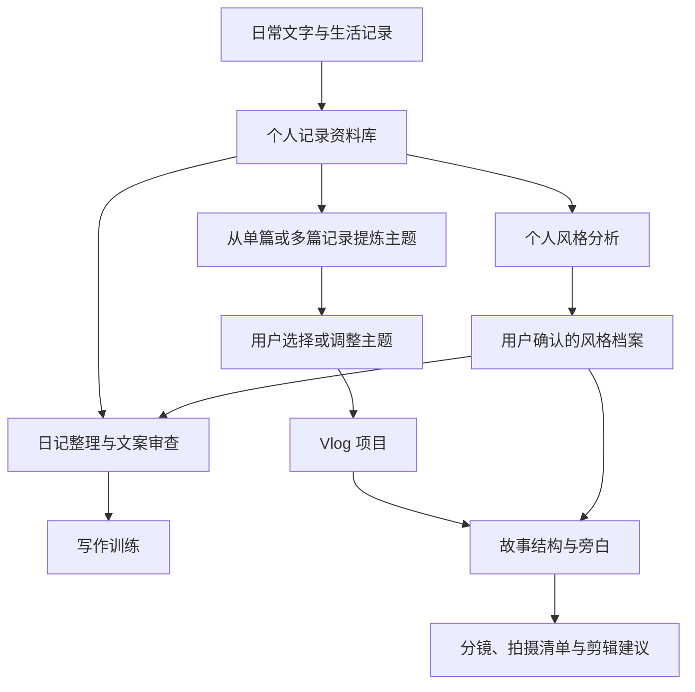

# LifeStory Studio：对话整理与桌面端产品需求

整理日期：2026 年 10 月 14 日

文档用途：供产品方向审阅，作为后续需求细化的依据。

来源：ChatGPT 对话「了解 diary-conversation技能」及当前对话。

## 1. 产品定位

LifeStory Studio 是面向个人的生活记录、写作成长与 Vlog 创作桌面软件。用户持续记录日常经历，软件帮助整理日记、审查文案、改善写作，并从长期积累的记录中寻找故事主题，形成可执行的视频策划、旁白和分镜。

最新决定：产品以 **Tauri 桌面应用**为载体。此前的 Skill 工作流可作为能力设计的参考，产品的使用入口、资料管理和创作过程应围绕桌面软件重新组织。

一句话目标：**让生活记录成为长期积累的个人创作资料，让写作和影像作品保留自己的表达。**

## 2. 对话如何发展到这个方向

| 阶段 | 用户表达 | 对产品的意义 |
|---|---|---|
| 了解对话式日记 | 询问 diary-conversation 技能 | 探索通过聊天回忆生活、整理日记的方式 |
| 了解视频脚本能力 | 询问 content-video-script-writer 技能 | 关注视频策划、旁白、镜头与叙事节奏 |
| 提出整合需求 | 希望整理日记、审查文案、提升写作并辅助 Vlog 创作 | 将记录、写作与影像创作连接起来 |
| 明确使用方式 | 希望在 Codex 使用，并需要可视化平台 | 需要可浏览、管理、编辑的持久化资料空间 |
| 修正 Vlog 逻辑 | 从单篇或多篇日记提炼主题，不限制一篇日记对应一条视频 | 以主题组织创作，支持跨篇、跨日期和素材复用 |
| 确认风格档案 | 要求加入个人写作风格档案，减少 AI 腔 | 长期了解用户表达习惯，帮助形成个人风格 |
| 最新产品决定 | 不应局限于 Skill，希望做成 Tauri 桌面软件 | 从工具工作流转向完整桌面产品 |

## 3. 用户已经明确的需求

### 3.1 日常记录与日记整理

用户会持续写日记，需要将已有文字和零散记录整理成便于阅读、检索与后续使用的内容。整理应保留真实经历、原意和个人表达。

对话式记录是此前讨论的重要启发：用户可以先讲述经历，再由助手协助整理。具体是否支持语音输入、图片输入及其处理方式，尚未确认。

### 3.2 文案审查与写作提升

软件应帮助发现文案的问题，并帮助用户提升写作水平。审查与训练需要相互衔接：指出具体问题、解释原因、给出修改方向，让用户逐渐掌握表达方法。

此前助手提出先看结构、再看语言，提供训练而非只输出改写稿。这是适合进一步细化的设计建议，尚未形成最终交互规范。

### 3.3 从生活资料中提炼 Vlog 主题

这是用户明确修正过的核心需求：

> “从我的单篇或者很多篇中整理出主题，vlog 的策划旁白分镜……不会仅仅限制在日记和 vlog 单片一一对应的局限性。”

产品必须允许：

- 从单篇记录挖掘主题，也能综合多篇记录。
- 从不同时间的记录中寻找共同经历、情绪变化或故事线。
- 一个 Vlog 引用多篇日记，同一篇日记参与多个 Vlog。
- 用户自行确定主题，也能让 AI 提出主题候选。
- 围绕选定主题组织叙事，而非机械地按日记日期拼接。

日记是可复用的创作来源。主题与视频项目需要有独立的组织空间。

### 3.4 Vlog 策划、旁白与分镜

主题确定后，软件需要帮助形成视频策划、旁白和分镜。此前讨论还包含故事结构、拍摄清单、B-roll、环境音、补拍计划和剪辑建议，这些可作为策划成果的细化方向。

分镜应能支持实际拍摄与剪辑。已有素材与建议补拍的镜头应清楚区分，避免把创作建议当成已经发生或已经拍摄的事实。

### 3.5 个人写作风格档案

用户已明确要求加入这一能力。目标是逐渐掌握个人表达习惯，减少 AI 腔，使整理稿与旁白更接近用户自己的语言。

此前助手提出的档案内容包括句式、叙事节奏、情感表达、擅长的描写方式、常见问题及值得保留的特色表达。分析应引用真实原文；风格判断先供用户审阅，确认后再进入长期档案。这些规则建议保留，待正式需求确认。

### 3.6 可视化桌面平台

用户已明确需要可视化平台，并进一步选择 Tauri 桌面软件。记录、历史浏览、文案审查、主题组织、Vlog 项目与风格档案应形成连贯的使用体验。

此前要求在 Codex 使用，是当时 Skill 方案下的选择。桌面化后是否继续连接 Codex，以及 AI 能力如何接入，需要重新确定。

## 4. 核心工作流

用户可以只记录日记，也可以只进行写作训练；进入 Vlog 创作时，再选择适合当前主题的历史资料。无需强制每篇日记完成全部流程。

## 5. 桌面端功能空间建议

以下是根据对话整理出的信息架构建议，供审阅，并非已经确定的页面设计。

| 功能空间 | 主要任务 | 主要成果 |
|---|---|---|
| 日记与记录 | 自由记录、整理、浏览与检索 | 原始记录、整理稿 |
| 写作工作台 | 审查文字、比较修改、进行训练 | 审查意见、修改稿、练习反馈 |
| 主题工作台 | 选择跨篇资料、寻找线索、比较主题 | 主题候选、来源依据、故事方向 |
| Vlog 项目 | 组织主题、旁白、分镜与拍摄计划 | 可继续编辑的策划与执行资料 |
| 个人风格 | 查看分析依据、确认或调整表达偏好 | 经过确认的风格档案 |
| 回顾空间 | 回看生活变化与写作成长 | 周/月/年度回顾；此前助手建议，待确认 |

原文、整理稿和发布用途的文案建议分开保存。用户应能回到原始记录，并看懂 AI 修改了什么。

## 6. 资料之间的关系

以下关系用于说明产品逻辑，不是数据库设计。

| 资料 | 含义 | 关系 |
|---|---|---|
| 原始记录 | 用户真实写下或讲述的内容 | 可形成整理稿、被审查、被多个主题引用 |
| 整理稿 | 根据原始记录形成的日记版本 | 保留对应原文与修改依据 |
| 审查与练习 | 具体问题、建议和训练反馈 | 关联原文或稿件，可积累写作问题 |
| 主题 | 从资料中提炼出的创作方向 | 可引用一篇或多篇记录 |
| Vlog 项目 | 围绕一个创作目标组织的作品 | 关联主题、来源、旁白、分镜和拍摄计划 |
| 风格档案 | 用户确认的表达习惯与偏好 | 引用原文证据，影响后续整理与创作 |
| 图片与视频素材 | 实际可用的视觉资料 | 管理方式及自动分析范围待确认 |

## 7. 应保留的产品原则

以下原则结合用户要求与此前工作流建议整理：

1. **保留真实生活。** 整理不虚构经历、情绪、对白或已有镜头；创作建议应标明。
2. **保留个人表达。** 不将每篇记录统一改成抒情散文，不用固定套路替代用户的声音。
3. **允许自由记录。** 不要求用户每天按模板写，也不要求每条记录都适合公开创作。
4. **让建议有依据。** 审稿、主题与风格分析能够关联到真实原文。
5. **让用户掌握决定权。** 用户能选择、修改或拒绝整理建议、主题及风格判断。
6. **支持长期积累。** 日记、写作经验与创作成果可持续保存、检索和复用。
7. **围绕最终目标设计。** 遵循用户要求，不以临时或不成熟的替代方案作为交付目标；未明确要求时不自行实施兜底方案。

## 8. 此前方案的交付状态如何理解

此前助手声称创建了 v1.0/v1.1 Skill 包、本地 Web 平台、SQLite 持久化及相关测试，并提供了对话环境中的 ZIP 下载链接。其描述的 Web 平台负责资料管理，AI 操作通过 Codex 完成，尚未内置 AI 对话或自动视频素材分析。

**这些是历史对话中的交付声明，当前未核验安装包、源码或运行结果，不能直接认定为桌面端的现有实现。** 本次读取的对话未返回可检查的附件，当前项目文件检索也未发现已有 Markdown 文档。

此前 Python、SQLite、数据库路径、六个页面及版本编号属于旧方案，不自动成为新桌面软件的技术约束。是否复用旧文件，应在获得并审查实际产物后决定。

## 9. 尚未确定的产品事项

这些事项留待阅读本整理稿后讨论，不影响当前需求总结。

| 事项 | 需要明确的内容 |
|---|---|
| 支持平台 | 先面向 macOS，还是同时支持 Windows/Linux |
| AI 接入 | 连接 Codex、直接接入模型服务、支持本地模型，或其他方式；服务与费用如何配置 |
| 记录入口 | 文字、对话、语音、图片分别需要哪些能力 |
| 数据与隐私 | 保存位置、发往模型的数据范围、备份、导入导出、加密与同步需求 |
| 素材处理 | 是否管理视频文件，是否需要转录、画面分析、素材检索 |
| 剪辑协作 | 仅提供剪辑建议，还是需要向剪辑软件导出可用资料；此前提及达芬奇属助手建议 |
| 长期回顾 | 是否纳入周期回顾、年度故事及写作成长追踪 |
| 主动提醒 | 是否需要记录提醒、回顾提醒，及触发方式 |
| Codex Skill 的角色 | 保留为可选外部入口，还是将相关流程全部纳入应用 |

## 10. 用于后续验收的目标场景

以下场景由已明确需求推导，用于检查后续方案是否偏离目标。

- **持续写日记：** 用户保存多天的记录，之后能找到原文并继续整理。
- **提升写作：** 用户提交文案后，得到具体问题与修改理由，并能据此练习。
- **跨篇策划：** 用户选择多篇不同日期的记录，获得有原文依据的主题，再完成旁白和分镜。
- **自由复用：** 同一篇日记能参与不同 Vlog，修改一个项目不会破坏其他项目或原始日记。
- **保留风格：** 用户能查看风格判断的原文依据，确认或纠正判断，后续文案体现其表达偏好。
- **桌面使用：** 用户通过 Tauri 桌面软件完成日常资料管理与创作操作；AI 接入方式确定后，再明确完整使用链路。

本次交付到此为止：整理对话与桌面产品需求，供用户审阅。具体架构、界面和实现计划在需求进一步确认后制定。
